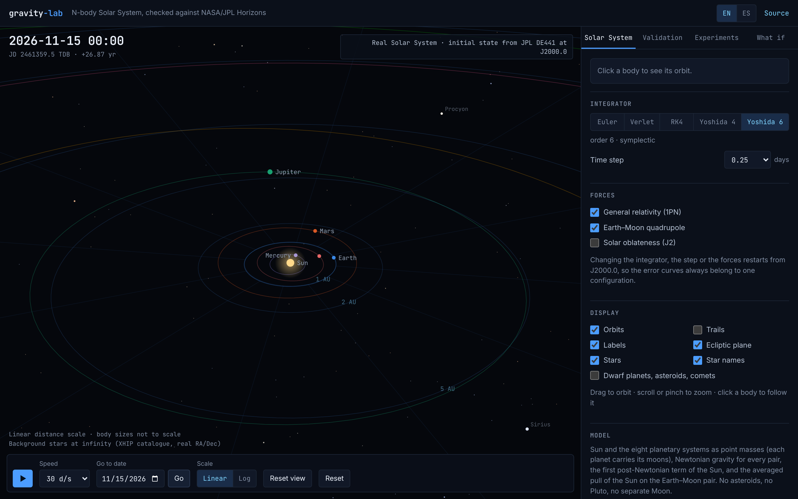

# gravity-lab

Un simulador de N cuerpos del sistema solar que enseña su propio error.

Parte de los vectores de estado de NASA/JPL en J2000.0, integra por su
cuenta y compara cada planeta con la efeméride del JPL sobre la marcha. Tras
un siglo, Mercurio está a 9 km de donde dice el JPL, y la precesión
relativista de su perihelio sale 42,98 segundos de arco por siglo, medida y
no supuesta.

**Web:** https://didimacveg.github.io/gravity-lab/?lang=es &nbsp;·&nbsp;
[README completo, en inglés](README.md) &nbsp;·&nbsp;
[La física explicada desde cero](docs/DEFENSA.md)



## Validación contra JPL Horizons

Error máximo de posición heliocéntrica frente a la efeméride DE441, modelo
completo, Yoshida 6 con paso de 0,25 días:

| Planeta | 1 año | 10 años | 100 años |
|---|---|---|---|
| Mercurio | 0,1 km | 1,0 km | 9,3 km |
| Venus | 0,03 km | 0,3 km | 3,5 km |
| Tierra (baricentro Tierra-Luna) | 7,8 km | 41 km | 303 km |
| Marte | 0,07 km | 4,9 km | 32 km |
| Júpiter | 0,2 km | 0,9 km | 33 km |
| Saturno | 0,2 km | 5,8 km | 19 km |
| Urano | 0,3 km | 3,5 km | 276 km |
| Neptuno | 0,3 km | 2,8 km | 656 km |

La tabla completa, con todos los integradores y pasos, está en
[docs/validation_table.md](docs/validation_table.md).

Comparar con una referencia externa destapó dos problemas que los tests
anteriores no veían:

- **Un fallo de primer orden en un integrador de cuarto orden.** La fuerza
  relativista depende de la velocidad y Verlet la evaluaba con una velocidad
  del paso anterior. Mercurio acababa a 1,66 millones de km. Corregido
  evaluándola en la velocidad de medio paso.
- **La Luna.** Tratar Tierra y Luna como un punto costaba 117 km al año.
  Añadiendo el efecto promediado de que el Sol tira de las dos por separado,
  el error de la Tierra baja de 11 686 km a 303 km, sin ajustar nada.

## El perihelio de Mercurio

| Medida | Resultado | Referencia |
|---|---|---|
| Sistema solar, corrida 1PN menos corrida newtoniana | 42,976″/siglo | 42,98 |
| Sol y Mercurio solos, con 1PN | 42,970″/siglo | fórmula de Einstein: 42,981 |
| Avance total, simulación | 572,14″/siglo | DE441, mismo ajuste: 572,18 |
| Sol y Mercurio solos, newtoniano (control) | 0,000″/siglo | 0 |

La versión anterior daba 42,81 y lo llamaba error del 0,4 %. Era geometría:
medía el perihelio proyectado sobre la eclíptica, y la órbita de Mercurio
está inclinada 7°. El factor de proyección es 0,996.

## Experimentos guiados

| Experimento | Comprobación | Resultado |
|---|---|---|
| Perihelio de Mercurio | 1PN menos newtoniano | 42,976″/siglo |
| Puntos de Lagrange | Periodo de libración en L4 | medido 147,3 años, teoría 147,3 |
| | Seis troyanos reales frente a Horizons, 100 años | peor error 199 km |
| Asistencia gravitatoria | Voyager 2 en Júpiter | 9,97 → 19,98 km/s (JPL: 19,95) |
| Integradores | Orden de convergencia medido | 0,97 · 2,00 · 4,20 · 4,00 · 5,91 |

## Reproducirlo

```bash
cmake -B build -DCMAKE_BUILD_TYPE=Release && cmake --build build -j
```

```bash
./build/gl_tests
```

```bash
cd web && npm test
```

Para ver la web en local:

```bash
cd web && python3 -m http.server 8000
```

## Cómo se ha hecho

El código de este repositorio se escribió con ayuda de IA (Claude Code, de
Anthropic), bajo mi dirección y revisión. Lo digo con claridad porque lo
contrario sería deshonesto. Lo interesante del proyecto no es quién lo
tecleó, sino que cada afirmación está respaldada por un test que cualquiera
puede ejecutar.

## Datos

Efemérides: NASA/JPL Solar System Dynamics, Horizons System (DE441), datos
descargados el 16 de noviembre de 2026, https://ssd.jpl.nasa.gov. Estrellas:
catálogo XHIP (Anderson y Francis 2012). Este proyecto no está afiliado a la
NASA ni al JPL.

## Autor

Diego Macías Vega · [github.com/didimacveg](https://github.com/didimacveg)

Licencia MIT.
