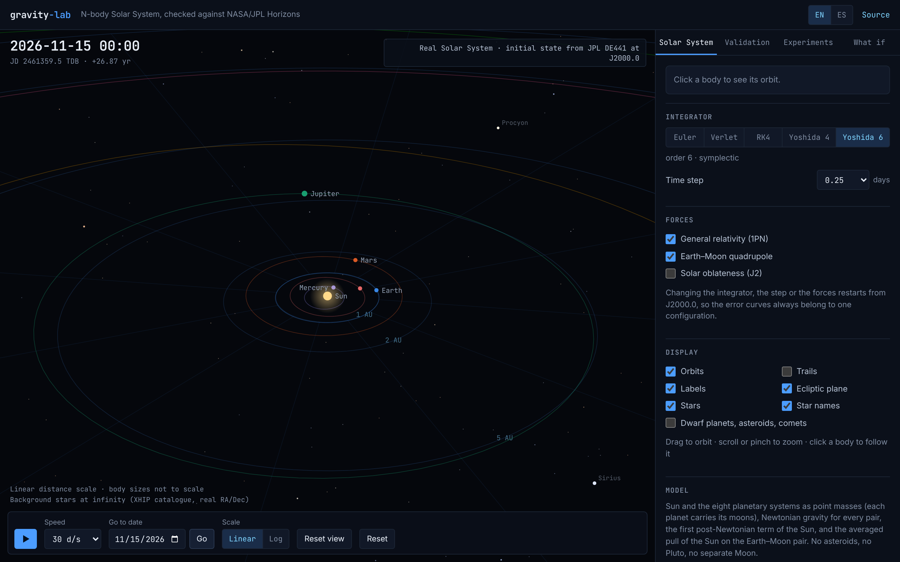
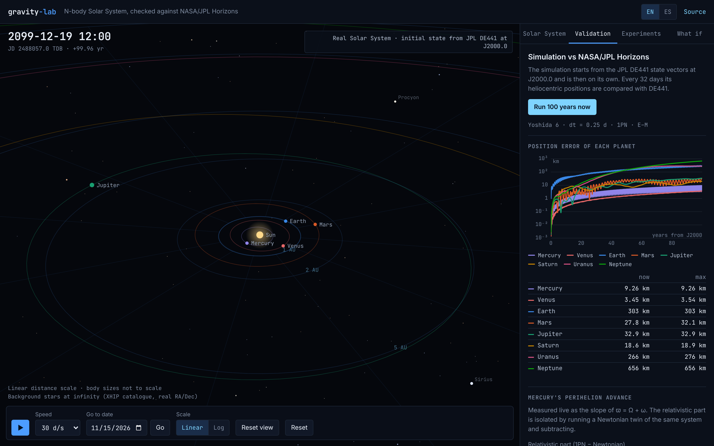
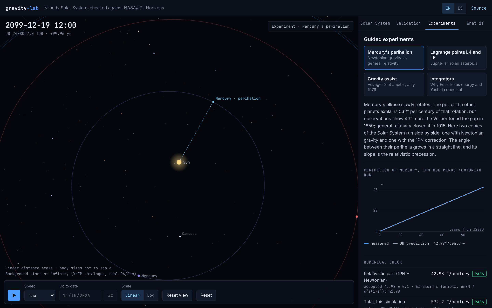
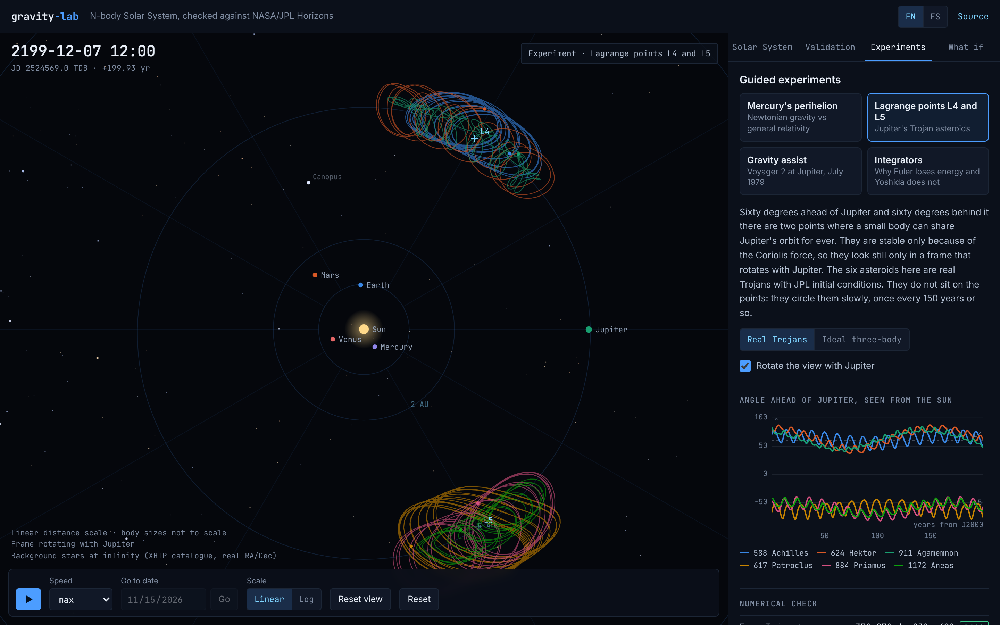
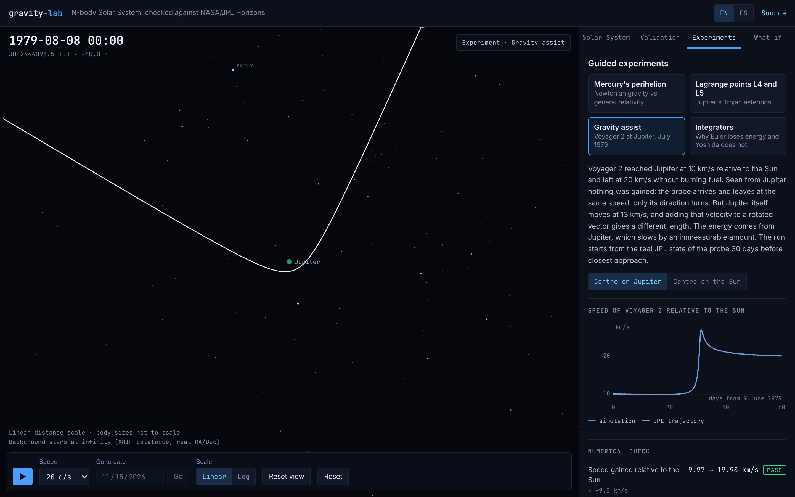
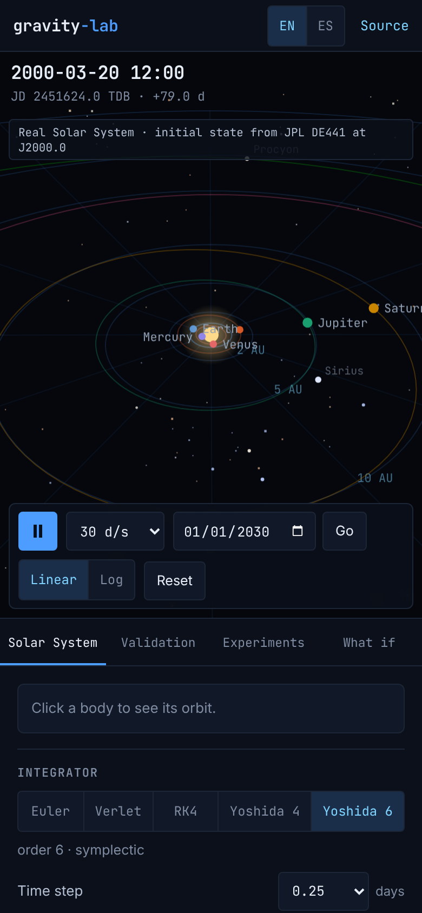

# gravity-lab

An N-body simulator of the Solar System that shows its own error.

It starts from NASA/JPL state vectors at J2000.0, integrates on its own, and
compares every planet with the JPL ephemeris as it goes. After a century
Mercury is 9 km from where JPL says it is, and the relativistic precession of
its perihelion comes out at 42.98 arcseconds per century, measured rather
than assumed.

**Live:** https://didimacveg.github.io/gravity-lab/ &nbsp;·&nbsp;
**Tests:** 
&nbsp;·&nbsp; [Versión en español](README.es.md)



The physics core is C++17 with no dependencies. The browser version is a
JavaScript port of the same code, with no build step and no libraries, and is
held to the same numbers by its own test suite.

## Validation against JPL Horizons

Orbit simulators are easy to write and easy to get subtly wrong, and a
simulation that conserves energy can still put a planet in the wrong place.
The only convincing check is an external reference.

The reference here is the JPL planetary ephemeris DE441, served by the
[Horizons system](https://ssd.jpl.nasa.gov/horizons/). The procedure:

1. Download the barycentric state of the Sun and the eight planetary systems
   at J2000.0. These are the initial conditions.
2. Download their positions every 32 days from 1900 to 2100.
3. Integrate from J2000.0 with no further input.
4. Every 32 days, measure the distance between each simulated planet and its
   DE441 position, relative to the Sun.

Maximum heliocentric position error over 1, 10 and 100 years, full model,
Yoshida 6 at a 0.25-day step:

| Planet | 1 yr | 10 yr | 100 yr |
|---|---|---|---|
| Mercury | 0.1 km | 1.0 km | 9.3 km |
| Venus | 0.03 km | 0.3 km | 3.5 km |
| Earth-Moon barycentre | 7.8 km | 41 km | 303 km |
| Mars | 0.07 km | 4.9 km | 32 km |
| Jupiter | 0.2 km | 0.9 km | 33 km |
| Saturn | 0.2 km | 5.8 km | 19 km |
| Uranus | 0.3 km | 3.5 km | 276 km |
| Neptune | 0.3 km | 2.8 km | 656 km |

For scale, Mercury travels 1.5 × 10¹¹ km in that century.

The same run for every integrator and step, error after 100 years:

| Integrator | Step (days) | Mercury | Earth | Neptune | max \|ΔE/E\| |
|---|---|---|---|---|---|
| Yoshida 6 | 0.25 | 9.3 km | 303 km | 656 km | 7 × 10⁻¹¹ |
| Yoshida 6 | 1 | 8,663 km | 303 km | 656 km | 1 × 10⁻¹⁰ |
| Yoshida 4 | 0.0625 | 132 km | 303 km | 656 km | 7 × 10⁻¹¹ |
| Yoshida 4 | 0.25 | 35,607 km | 274 km | 656 km | 1 × 10⁻¹⁰ |
| RK4 | 0.25 | 57,848 km | 300 km | 656 km | 9 × 10⁻¹⁰ |
| Verlet | 0.25 | 1.6 × 10⁷ km | 6.0 × 10⁵ km | 653 km | 2 × 10⁻⁷ |
| Euler | 0.25 | 1.1 × 10⁹ km | 5.4 × 10⁸ km | 3.0 × 10⁶ km | 5 × 10⁻² |
| Yoshida 6, no Earth-Moon term | 0.25 | 9.3 km | 11,686 km | 656 km | 2 × 10⁻¹¹ |
| Yoshida 6, no relativity | 0.25 | 18,096 km | 5,783 km | 696 km | 5 × 10⁻¹¹ |

The full table, with all eight planets and three time spans, is in
[docs/validation_table.md](docs/validation_table.md). Two things in it are
worth noticing. Yoshida 4 and Yoshida 6 conserve energy almost equally well
at 0.25 days, yet their position errors differ by a factor of 4,000: energy
conservation is necessary and far from sufficient. And the outer planets
come out the same with every reasonable method; it is Mercury, with its
88-day orbit, that demands a fine step.



### What the comparison found

Running against Horizons for the first time exposed two problems that every
earlier test had passed.

**A first-order bug in a fourth-order integrator.** With relativity switched
on, Mercury ended the century 1.66 million km off, worse than without it. The
1PN force depends on velocity, and the kick-drift-kick step was evaluating it
with a velocity left over from the previous step. That breaks the time
symmetry of the scheme and drops it to first order. The fix evaluates the
velocity-dependent term at the half-step velocity in both kicks, which makes
the first kick implicit (solved by fixed-point iteration, two rounds are
enough). Time reversibility and fourth-order convergence come back, and
three regression tests now guard them.

**The Moon.** The model treats Earth and Moon as one point at their
barycentre. That put Earth 117 km further ahead every year. The Sun pulls on
the two bodies separately, and averaged over a month the difference from
pulling on their barycentre is a radial 1/r⁴ force (Quinn, Tremaine and
Duncan 1991). Adding it, with every constant taken from measured values and
none fitted, cut Earth's error from 11,686 km to 303 km.

### What still limits it

The model, not the integrator: at this step, halving it changes nothing.
DE441 has things this simulator does not: the Moon as a separate body, 343
asteroids, Pluto and the Kuiper belt, relativity between every pair of
bodies, and non-spherical shapes. I have not separated how much each
contributes to the residual of Uranus and Neptune. Adding Pluto as a massive
body did not improve Neptune, so I make no claim about it.

## Mercury's perihelion

The perihelion of Mercury advances about 574 arcseconds per century. Other
planets account for 532 of them. The remaining 43 went unexplained from 1859
until general relativity in 1915.

The simulator does not contain Einstein's precession formula. It contains
the first post-Newtonian force, and the precession is measured: two copies
of the Solar System run side by side, one Newtonian and one with the 1PN
term, and the angle between their perihelia grows linearly.

| Measurement | Result | Reference |
|---|---|---|
| Full Solar System, 1PN run minus Newtonian run | 42.976″/century | 42.98 |
| Sun and Mercury only, 1PN | 42.970″/century | Einstein's formula: 42.981 |
| Total advance, simulation | 572.14″/century | DE441, same fit, same dates: 572.18 |
| Sun and Mercury only, Newtonian (control) | 0.000″/century | 0 |

Because everything common to both runs cancels in the difference, the
measurement survives a coarse integrator: Yoshida 4 at 0.25 days has 165″ of
spurious precession per century and still returns 42.98.

An earlier version of this project reported 42.81 and called it a 0.4%
error. It was geometry. The code measured the perihelion direction projected
on the ecliptic, and Mercury's orbit is inclined 7°. The projection slows
the apparent rate by cos i / (cos²ω + cos²i sin²ω) = 0.996, and
42.98 × 0.996 = 42.81. Measured as the longitude of perihelion, Ω + ω, the
textbook value appears. The old test is still in the suite, untouched.



## Guided experiments

Each one has a short explanation in the app and a numerical check that also
runs in CI.

| Experiment | What is checked | Result |
|---|---|---|
| Mercury's perihelion | 1PN minus Newtonian precession | 42.976″/century (accepted 42.98) |
| Lagrange points | Libration period at L4, ideal three-body problem | measured 147.3 yr, theory 147.3 yr |
| | Six real Jupiter Trojans, 1000 years | all stay 30° to 95° from Jupiter |
| | The same Trojans against Horizons after 100 years | worst error 199 km |
| Gravity assist | Voyager 2 at Jupiter, heliocentric speed | 9.97 → 19.98 km/s (JPL: 19.95) |
| | Closest approach to Jupiter's centre | 721,965 km (real: 721,670) |
| | Speed relative to Jupiter, in and out | 7.647 and 7.642 km/s |
| Integrators | Measured order of convergence | Euler 0.97, Verlet 2.00, RK4 4.20, Yoshida 4.00 and 5.91 |

The Voyager 2 run starts from the real JPL state of the probe 30 days before
closest approach. Its position error is 423 km just before the fly-by and
175,000 km thirty days after. The jump is expected: an encounter amplifies
small differences, and the model has no Jupiter oblateness, no Galilean
moons and none of the probe's course corrections.

| | |
|---|---|
|  |  |

## The app

- 3D view with an orbit camera, the ecliptic plane, linear or logarithmic
  distance scale.
- Real calendar date (TDB), pause, speed from 1 day per second to as fast as
  the machine allows, and "go to date" between 1900 and 2100, forwards or
  backwards.
- Background stars are the 2,851 stars down to magnitude 5.5 of the XHIP
  catalogue at their real right ascension and declination, drawn on a
  celestial sphere at infinity. They rotate with the camera and do not move
  or scale with the orbits.
- A separate "What if" tab holds the hypothetical scenarios (a black hole or
  a passing star crossing the system). They are labelled as hypothetical and
  are not part of the validated simulation.
- English by default, Spanish one click away.
- Works on a phone. Respects `prefers-reduced-motion` (starts paused).



## Physics implemented

- Newtonian N-body gravity, pairwise, with Newton's third law enforced by
  construction.
- First post-Newtonian correction (Einstein-Infeld-Hoffmann, dominant
  central body form), integrated time-symmetrically.
- Averaged Earth-Moon quadrupole.
- Solar oblateness, J2 = 2.2 × 10⁻⁷ (optional; about 0.03″/century on
  Mercury).
- Integrators: explicit Euler, RK4, velocity Verlet, Yoshida 4, Yoshida 6.
- Osculating elements from the Laplace-Runge-Lenz vector; energy including
  the 1PN term.
- For the hypothetical scenarios only: adaptive substepping, pericentre
  capture criterion at 3 r_s, momentum-conserving accretion.

## Reproduce it

Requirements: a C++17 compiler, CMake, and Node 22 or newer for the web
tests.

```bash
cmake -B build -DCMAKE_BUILD_TYPE=Release && cmake --build build -j
```

The 52 validation cases, including the Horizons comparison (about 40
seconds):

```bash
./build/gl_tests
```

The validation table above, written to `out/validation.md` and
`out/validation.json`:

```bash
mkdir -p out && ./build/gl_validate out
```

The same checks on the JavaScript port:

```bash
cd web && npm test
```

Run the app locally (ES modules need a server; opening the file from disk
does not work):

```bash
cd web && python3 -m http.server 8000
```

Download the reference data again from JPL (optional; the cached copy is in
`web/data` and the tests run offline):

```bash
python3 tools/fetch_horizons.py
```

CI runs all of the above on every push, plus a browser test that loads the
page, runs a century and reads the numbers off the validation panel.

## Layout

```
core/        physics in C++17, no dependencies
  forces.*        Newtonian gravity, 1PN, J2, Earth-Moon quadrupole
  integrator.*    Euler, RK4, Verlet, Yoshida 4 and 6, adaptive stepping
  reference.*     DE441 initial conditions and error against the reference
  analysis.*      orbital elements, precession rate
  horizons_data.hpp   generated by tools/fetch_horizons.py
tests/       52 validation cases, 40-line in-house framework
bench/       gl_bench (energy drift), gl_validate (table against Horizons)
web/         the app: index.html, css/, js/, data/
  js/physics.js   port of core/, shared by the app and its tests
  tests/          21 Node tests; e2e/ has the browser test
  data/           cached JPL reference, star catalogue, validation table
tools/       fetch_horizons.py, build_stars.py, media scripts
docs/        DEFENSA.md (the physics, in Spanish), decisions, status
```

## Data and credits

- **Ephemerides:** NASA/JPL Solar System Dynamics, Horizons System, planetary
  ephemeris DE441. Data retrieved on 2026-11-16. https://ssd.jpl.nasa.gov.
  Giorgini et al. (1996), Bull. AAS 28, 1158; Park et al. (2021), AJ 161, 105.
  The data are downloaded once by `tools/fetch_horizons.py`, one request at a
  time, and cached in the repository; neither the tests nor the app contact
  JPL. This project is not affiliated with or endorsed by NASA or JPL.
- **Stars:** XHIP, An Extended Hipparcos Compilation (Anderson and Francis
  2012, VizieR V/137D), through the data files of
  [d3-celestial](https://github.com/ofrohn/d3-celestial) (BSD-3-Clause).
- **Fonts:** Inter and JetBrains Mono, SIL Open Font License, self-hosted.
- **Methods:** Yoshida (1990), Phys. Lett. A 150, 262; Quinn, Tremaine and
  Duncan (1991), AJ 101, 2287.

## How this was built

The code in this repository was written with AI assistance (Claude Code,
Anthropic), under my direction and review. I decided what the project had to
demonstrate and what would count as evidence: a comparison with an external
reference, with the error on screen, rather than a simulation that only
agrees with itself. I reported the defects of the earlier version (stars
drawn among the planets, hypothetical scenarios mixed with the real system,
a Spanish-only interface).

I say this plainly because the alternative would be dishonest, and because
the interesting part of the project is not who typed it. It is that every
claim above is backed by a test anyone can run.
[docs/DEFENSA.md](docs/DEFENSA.md) (in Spanish) explains the physics from
first principles, piece by piece.

## Known limitations

- No separate Moon, no asteroids, no Pluto: see "What still limits it".
- The 1PN term is applied relative to the Sun only, not between all pairs.
- The Sun's J2 axis is taken along the ecliptic normal; the real solar pole
  is tilted 7°.
- The black-hole scenarios are Newtonian gravity with a capture criterion,
  not general relativity. They are thought experiments.
- The 3D view is drawn on a 2D canvas, which is plenty for twenty bodies but
  would not scale to an asteroid belt.

## Author

Diego Macías Vega · [github.com/didimacveg](https://github.com/didimacveg)

## License

MIT. See [LICENSE](LICENSE).
